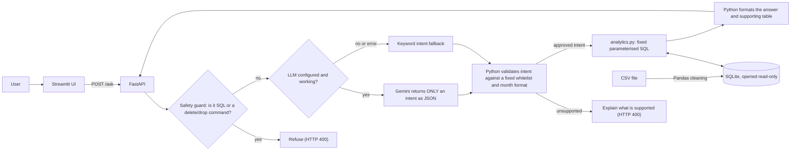

# Mini AI Business Intelligence Assistant

Ask questions about sales data in plain English and get answers that are backed by real SQL queries.

Built for the *AI-Assisted Development Challenge – GET (Python with Generative AI)*.
Target effort 3–4 hours, so the design favours **correctness and explainability over features**.

---

## 1. What it does

| # | Question the assistant answers | Example |
|---|---|---|
| 1 | Total revenue | *What is the total revenue?* |
| 2 | Top product by revenue | *Which product generated the highest revenue?* |
| 3 | Monthly revenue trend | *What is the monthly revenue trend?* |
| 4 | Top region by revenue | *Which region generated the highest sales?* |
| 5 | Revenue change between two months | *How did revenue change between January and February 2026?* |

**All five** required questions are supported.

### Features
- Cleans the supplied CSV with Pandas and **explains every rejected row**; the original CSV is never modified.
- Stores clean data in SQLite with typed columns and `CHECK` constraints.
- `POST /ask` FastAPI endpoint returning structured JSON, with input validation and proper HTTP status codes.
- **LLM interprets the question; Python validates; SQL calculates.** The LLM never sees data, never writes SQL, never produces a number.
- Works with **no LLM key at all** (keyword/intent fallback). The response always states which interpreter was used.
- Streamlit UI: example questions, answer, key figures, supporting table, chart, dataset/cleaning overview.
- Pytest suite using temporary databases.

### Technology stack
Python · Pandas · SQLite · FastAPI · Streamlit · Google Gemini (plain HTTP via `requests`, no AI framework) · Pytest · Git/GitHub

---

## 2. Architecture



### Why the answers can be trusted
1. **No generated SQL.** There are only five approved query functions in `app/analytics.py`. The LLM can only choose one of five intent names (or "unsupported").
2. **Untrusted AI output is validated.** The intent must be on the whitelist; months must match `YYYY-MM` and exist in the data. Anything else is discarded and the keyword fallback is used.
3. **Read-only database.** The API opens SQLite with `mode=ro`, so `INSERT/UPDATE/DELETE/DROP/ALTER` fail even if a bug existed. Text that looks like SQL or a destructive command is also refused up front.
4. **Numbers are never written by an LLM.** Answer sentences are built by Python templates from SQL results. (The LLM is used for *understanding*, not for *explaining*, so it cannot invent a figure.)
5. **Honest about gaps.** Unsupported questions get a clear message; requests we can't honour exactly (e.g. "total revenue in March") are declined instead of silently answered with the wrong number.

### How the data is stored and queried
| Table | Purpose |
|---|---|
| `sales` | One row per **accepted** transaction (`quantity > 0`, `unit_price > 0`, `discount >= 0`, status `Completed`/`Returned`). Has `order_month` (`YYYY-MM`) for monthly grouping. |
| `rejected_records` | One row per **rejected** CSV row: CSV line number, reason, and the original values. |
| `load_summary` | Total / accepted / rejected / completed / returned counts from the last load. |

Revenue is calculated **inside SQL**: `SUM(quantity * unit_price - discount_amount) ... WHERE status = 'Completed'`.

---

## 3. Data findings and business rules

The supplied CSV has **51 records** and 10 columns. Dates are `DD-MM-YYYY` (e.g. `03-01-2026` = 3 January; the middle field only ever holds 01–06 while the first goes up to 28, which confirms it).

| Check | Result |
|---|---|
| Duplicate transaction IDs | none |
| Date-format inconsistencies | none (all `DD-MM-YYYY`, Jan–Jun 2026) |
| Returned transactions | 1 (`TXN0033`, Monitor, West) |
| **Zero quantity** | 1 (`TXN0034`) -> rejected |
| **Missing unit price** | 1 (`TXN0051`) -> rejected |
| Result | **49 accepted** (48 Completed + 1 Returned), **2 rejected** |

**Assumptions** (the brief does not specify these):
- **Revenue = Quantity × Unit_price − Discount_amount.**
- **Returned transactions are excluded** from every revenue figure (the CSV has no refund information, so a returned sale is simply not revenue). Their count and value are still shown as supporting data.
- Invalid rows are **rejected and reported**, never repaired or guessed (e.g. a missing price is *not* filled in from other rows of the same product).
- Currency is assumed to be **INR (₹)** with Indian digit grouping (`₹14,39,200`). Change `CURRENCY_SYMBOL` in `.env` if wrong.
- "Which product/region generated the highest revenue/sales" ranks by **revenue**.

With these rules the total completed-sales revenue is **₹14,39,200** (48 transactions).

---

## 4. Project structure

```
mini-ai-bi-assistant/
├── app/
│   ├── main.py          # FastAPI app: POST /ask, GET /health, GET /dataset/summary
│   ├── database.py      # SQLite schema, building the DB, read-only connections
│   ├── data_loader.py   # Pandas CSV loading + cleaning rules
│   ├── analytics.py     # the 5 approved SQL analytics functions + currency formatting
│   ├── ai_handler.py    # intent detection (Gemini or keyword fallback) + answer formatting
│   ├── schemas.py       # Pydantic request/response models
│   └── config.py        # environment variables / settings
├── data/
│   └── ai_bi_assistant_sales_data - GET.csv
├── tests/
│   ├── conftest.py  test_data_loader.py  test_analytics.py  test_ai_handler.py  test_gemini_integration.py  test_api.py
├── frontend/
│   └── streamlit_app.py
├── .env.example  .gitignore  pytest.ini  requirements.txt
├── README.md
└── AI_DEVELOPMENT_NOTES.md
```

---

## 5. Setup and run

Requires **Python 3.10+**. Run all commands from the project folder.

### 5.1 Virtual environment and dependencies
```bash
python -m venv .venv

# macOS / Linux
source .venv/bin/activate
# Windows (PowerShell)
.venv\Scripts\Activate.ps1

pip install -r requirements.txt
```

### 5.2 (Optional) configure Gemini
1. Create a free key at https://aistudio.google.com/apikey
2. Create your settings file and open it:
   ```bash
   cp .env.example .env        # Windows: copy .env.example .env
   ```
3. Paste the key: `GEMINI_API_KEY=your-key-here` (no quotes, no spaces). Save.
4. Restart the backend (`.env` is read at start-up).

Skip this step to run with the keyword fallback. **Never commit `.env`**: it is listed in `.gitignore`, and the key is never returned by the API, shown in the UI, or written to logs.

### 5.3 Initialise the database
```bash
python -m app.database
```
This reads the CSV, prints how many records were accepted/rejected and why, and creates `data/sales.db`.
(The API also builds it automatically on first start if it is missing.)

### 5.4 Start the backend (terminal 1)
```bash
uvicorn app.main:app --reload
```
Interactive docs: http://localhost:8000/docs

### 5.5 Start the UI (terminal 2, same virtual environment)
```bash
streamlit run frontend/streamlit_app.py
```
Opens at http://localhost:8501.

### 5.6 Run the tests
```bash
pytest -v
```

---

## 6. API

### `POST /ask`
```bash
curl -X POST http://localhost:8000/ask \
  -H "Content-Type: application/json" \
  -d '{"question": "Which product generated the highest revenue?"}'
```
Real response (table shortened to 2 rows):
```json
{
  "question": "Which product generated the highest revenue?",
  "answer": "Monitor generated the highest revenue: ₹4,73,000 (32.9% of total completed-sales revenue).",
  "data": {"product": "Monitor", "revenue": 473000, "revenue_formatted": "₹4,73,000", "share_percent": 32.9, "tied": []},
  "supporting_table": [
    {"rank": 1, "product": "Monitor", "revenue": 473000, "revenue_display": "₹4,73,000", "share_percent": 32.9, "units_sold": 50, "transactions": 9},
    {"rank": 2, "product": "Desk", "revenue": 222500, "revenue_display": "₹2,22,500", "share_percent": 15.5, "units_sold": 18, "transactions": 6}
  ],
  "explanation": "Revenue = quantity x unit price - discount, summed over Completed transactions only; Returned transactions are excluded. Ranked by revenue across 7 products. Data quality: 2 of 51 CSV records were rejected during cleaning (zero or negative quantity x1, missing unit price x1) and are not counted.",
  "success": true,
  "intent": "highest_revenue_product",
  "interpreter": "keyword_fallback",
  "interpreter_note": "No LLM configured (GEMINI_API_KEY is not set); the keyword/intent fallback was used."
}
```
`interpreter` is `"llm"` only when the LLM really produced the intent; otherwise `"keyword_fallback"` with a note saying why.

| Status | When |
|---|---|
| `200` | Question answered |
| `400` | Unsupported question; missing/unknown months; SQL or destructive text |
| `422` | Invalid body (missing/blank/too short/too long `question`, wrong type, not JSON) |
| `503` | Database missing or unreadable |
| `500` | Unexpected error (details are logged, not returned) |

Failure responses use the **same JSON shape** with `"success": false`.

Other endpoints: `GET /health` (database + interpreter status), `GET /dataset/summary` (cleaning statistics and rejected rows).

### Example questions
```
What is the total revenue?
Which product generated the highest revenue?
What is the monthly revenue trend?
Which region generated the highest sales?
How did revenue change between January and February 2026?
Compare March vs April
Revenue in May and June
```
Expected results on the supplied data: total ₹14,39,200 · top product Monitor ₹4,73,000 · top region South ₹4,11,200 · January→February +₹24,350 (+11.6%) · highest month May 2026 (₹3,18,500), lowest January 2026 (₹2,10,250).

Declined on purpose: `What is the weather?`, `revenue by category`, `total revenue in March 2026` (single-month filter), `DROP TABLE sales`.

---

## 7. LLM vs. fallback

**The LLM interprets the question. Python and SQLite do the analytics.**

| | Gemini configured and working | No key / timeout / API error / invalid reply |
|---|---|---|
| Who picks the intent | Google Gemini (`generateContent` REST call in `_call_llm`) returns `{"intent": ..., "month_a": ..., "month_b": ...}` | Rule-based keyword matcher in `ai_handler.py` |
| Who validates | Python (intent must be one of 5 allowed names, months must be `YYYY-MM` and exist in the data) | Python |
| Who calculates | SQLite (predefined queries in `analytics.py`) | SQLite |
| `interpreter` in response | `"llm"` | `"keyword_fallback"` + `interpreter_note` saying why |

Allowed intents: `total_revenue`, `highest_revenue_product`, `monthly_revenue_trend`, `highest_sales_region`, `revenue_change_between_months` (anything else is `unsupported`).

What is sent to Gemini: the question text and the list of available months. **No sales data and no SQL.** What is used from the reply: only the `intent` and two month strings. Any other field Gemini returns (including numbers or "SQL") is ignored.

**The keyword fallback is used whenever the LLM is unavailable.** It is not an LLM and the app never pretends it is.

### How to check which interpreter was used
- API/Swagger: look at `"interpreter"` in the `/ask` response (`"llm"` or `"keyword_fallback"`), and `"interpreter_note"` for the reason.
- Streamlit: the sidebar says *Question interpreter: LLM (gemini)* or *keyword fallback*, and each answer shows *Interpreted by: ...*.
- `GET /health` shows `"interpreter"` without revealing the key.
- A question only an LLM would understand, e.g. *"Where are we making the most money geographically?"*: Gemini maps it to the top-region answer; the keyword fallback replies "I can't answer that yet".

---

## 8. Tests

`pytest -v` runs 140+ checks across five files, all against **temporary databases** (the real CSV is only read):

| File | Covers |
|---|---|
| `test_data_loader.py` | Cleaning rules, rejection reasons, DD-MM-YYYY dates, duplicates, original CSV unchanged |
| `test_analytics.py` | Each analytic vs an **independent pandas calculation** and vs a **hand-calculated** mini dataset; returned sales excluded; read-only DB; SQL-injection-style months; empty-data edge case; currency format |
| `test_ai_handler.py` | Keyword intents; unsupported/destructive questions; month parsing; the LLM path with a **faked** `_call_llm` (valid reply, fenced JSON, garbage reply, outage); LLM-unavailable fallback |
| `test_gemini_integration.py` | Gemini at the HTTP level with `requests.post` mocked: valid intent, invalid/garbled reply, `unsupported`, missing key, timeout / HTTP 4xx-5xx / bad structure -> fallback, key never in URL or output, numbers always from SQLite, LLM-supplied SQL never executed |
| `test_api.py` | `/ask` happy paths, 400/422/503 responses, startup DB build, `/health`, `/dataset/summary` |

Tests never call a real LLM (an auto-use fixture removes any API keys from the environment).

---

## 9. Known limitations
- Only the five question types are understood; others get a polite refusal. There is **no free-form text-to-SQL by design**.
- Single-month filters (e.g. "total revenue in March") and breakdowns by category/channel are **not supported yet**.
- Keyword fallback is rule-based: unusual phrasing may be refused even though an LLM would understand it.
- Month names without a year assume the dataset's year (valid only while the data spans one year).
- Product/region names are matched exactly as written in the CSV (no spelling normalisation).
- Currency is assumed INR; money is stored as `REAL` (fine for this data; use integers/`Decimal` for production).
- Return handling is a simplification: returned sales are excluded in full, with no partial refunds.
- LLM answers are not streamed and each question is independent (no conversation memory).
- The Gemini path needs internet access and a valid key. The tests mock Gemini, so run one real question yourself (see section 7) before relying on it. The default model name may be retired by Google; override it with `GEMINI_MODEL`.

---

## 10. Using Git and GitHub
```bash
git init
git add .
git commit -m "Mini AI BI assistant: data cleaning, SQLite, analytics, API, UI, tests"
git branch -M main
git remote add origin https://github.com/<your-username>/mini-ai-bi-assistant.git
git push -u origin main
```
Check `git status` first: `.env` and `data/sales.db` must **not** be listed.
